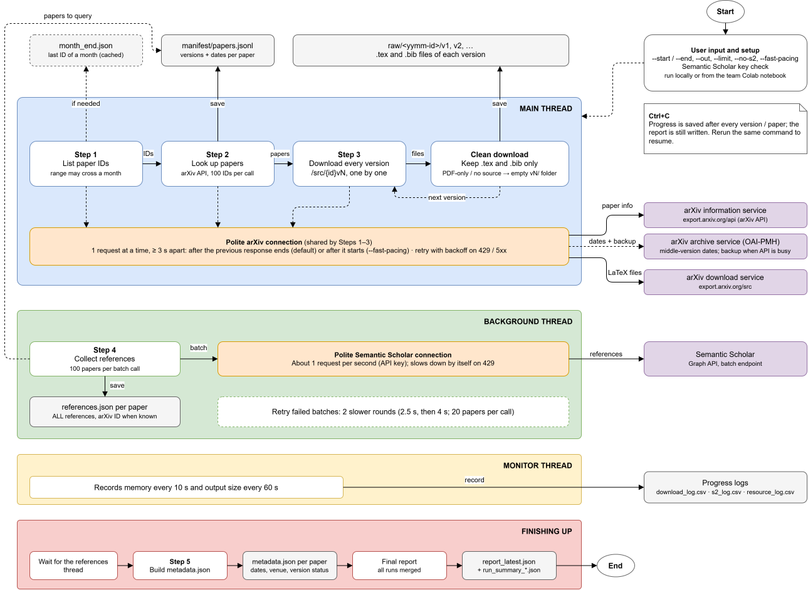
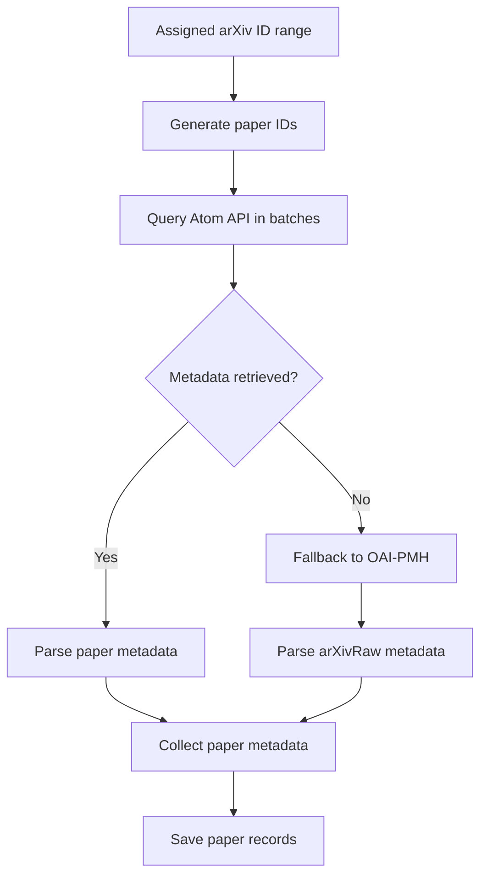
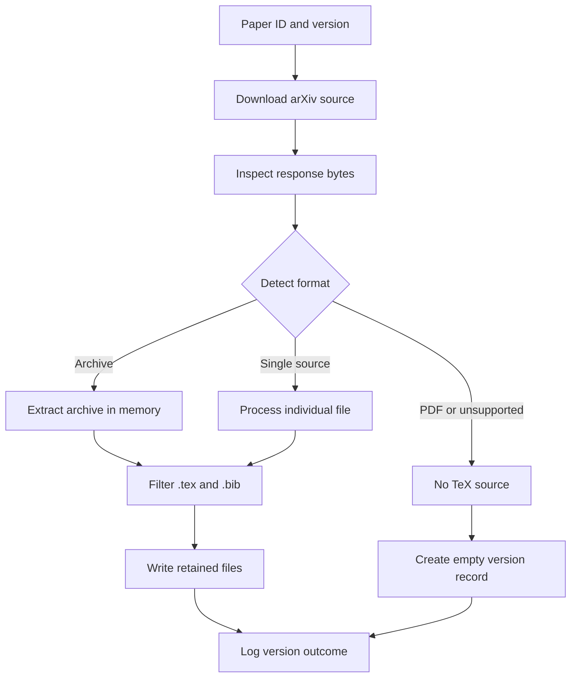
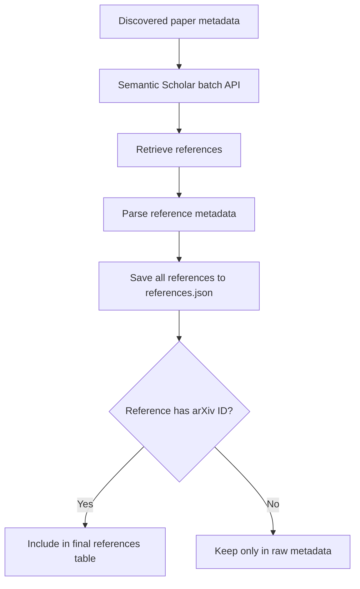
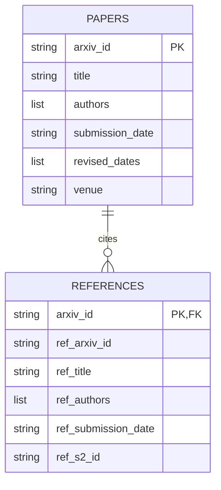

---
jupytext:
  text_representation:
    extension: .md
    format_name: myst
kernelspec:
  display_name: Python 3
  language: python
  name: python3
---

# Milestone 1: Data Crawling

## 1. Data crawling methodology

### 1.1. System Flow


### 1.2. Tools and Libraries Used

**Third-party Libraries**

| Library | Purpose |
|---|---|
| `requests` | HTTP client with a persistent `Session`, per-host headers (User-Agent and Semantic Scholar API key), and request timeouts. |
| `tqdm` | Displays progress bars for discovery and downloading, with `tqdm.write()` for logging messages without disrupting progress bars. |
| `psutil` | Monitors process and child-process RSS memory usage and reports available disk space. |

**Python Standard Library**

| Module | Purpose |
|---|---|
| `threading` | Manages the background Semantic Scholar thread, resource-monitoring thread, synchronization locks, and stop event. |
| `xml.etree.ElementTree` | Parses arXiv Atom API and OAI-PMH XML responses. |
| `gzip`, `tarfile`, `zipfile`, `io` | Decompresses and processes downloaded source payloads in memory. |
| `json`, `csv` | Stores manifests, paper metadata, reference metadata, execution summaries, and logs. |
| `pathlib`, `os`, `shutil` | Handles file paths, atomic file replacement, directory creation, and folder management. |
| `argparse` | Supports command-line arguments, including `--start`, `--end`, `--out`, `--limit`, `--no-s2`, and `--fast-pacing`. |
| `email.utils`, `datetime`, `time`, `re` | Handles RFC-2822 date parsing, UTC timestamps, time measurements, and text parsing. |

**External Services**

- **arXiv Atom API** (`export.arxiv.org/api/query`): Retrieves paper metadata and version counts in batches.
- **arXiv OAI-PMH** (`oaipmh.arxiv.org/oai`, `arXivRaw`): Retrieves individual version dates and provides fallback metadata when the Atom API is unavailable.
- **arXiv Source Endpoint** (`export.arxiv.org/src/{id}v{n}`): Downloads the LaTeX source archive for every available paper version.
- **Semantic Scholar Graph API** (`/paper/batch`): Retrieves reference metadata in batches. An optional API key can be provided through the `S2_API_KEY` environment variable or the `s2_api_key.txt` file.

### 1.3. Implementation 

#### 1.3.1. Discovery

Our implementation adopts two discovery mechanisms: the `arXiv Atom API` as a primary method for retrieving the paper metadata and `OAI-PMH` as a fallback.

1. `arXiv Atom API`: The crawler first constructs the list of paper identifiers within the assigned range. It then queries the arXiv Atom API in batches up to 100 IDs to retrieve metadata, including titles, authors, initial submission dates, and all available version information. Batch processing plays an important role in reducing the number of idividual API requests required for metadata discovery, thereby reducing request overhead and improving the efficiency of metadata retrieval

2. `OAI-PMH`: In some cases where the arXiv Atom API fails to retrieve the required metadata, the crawler falls back to the OAI-PMH interface using the arXivRaw metadata format. In addition to this fallback role, OAI-PMH supports month-boundary resolution when constructing the assigned ID range and retrieving intermediate version dates for papers with three or more versions. This provides more complete version information than relying solely on the initial and latest revision metadata.



#### 1.3.2. Versioned Source Downloading and Extraction

After collecting paper metadata, the crawler downloads the source files of every available version (v1, v2, v3, etc) using the arXiv source endpoint

```bash
https://export.arxiv.org/src/{arxiv_id}v{version}
```

Each version is processed separately to preserve the publication's revision history.

Because arXiv submissions may have different file formats, the crawler does not simply assume every downloaded file is a TAR archive. Instead, it inspects the downloaded bytes to identify the content type such as:
- Gzip-compressed TAR archives.
- Other TAR archives.
- Single source files.
- PDF files.
- DOC/DOCX files.
- PostScript and HTML files.

For supported archives, extraction is performed in memory to avoid storing unnecessary files on disk.

The crawler retains only .tex and .bib files while excluding figure binaries and unrelated files. Extensionless files identified as LaTeX sources are also saved with a .tex extension. Importantly, the original LaTeX content is preserved without modifying figure commands (like `\includegraphics`) or other source code.



#### 1.3.3. Non-TeX and Missing-Source Handling
However, not all arXiv versions provide usable LaTeX sources. To preserve dataset coverage, the crawler keeps an empty directory for versions without usable .tex files.

To resolve, the `unpack()` function identifies PDF and unsupported formats by inspecting the downloaded content:

```code
if data[:4] == b"%PDF":
    return "pdf", []

other = non_tex_kind(data)
if other:
    return other, []
```

For supported archives, `save_version()` extracts only .tex and .bib files. If no .tex file is found, the directory is cleared and recreated as an empty record:

```code
if kind in ("tar", "zip", "single") and not has_tex:
    shutil.rmtree(tmp_dir, ignore_errors=True)
    tmp_dir.mkdir(parents=True)
    kind, kept_bytes, n_kept = "no_tex", 0, 0
```

If the source endpoint returns HTTP 404, the crawler also preserves the version and records its status as `no_source`:

```code
if resp.status_code == 404:
    row.update(save_version(b"", target), status="no_source")
```

#### 1.3.4. Reference Metadata Extraction 

After the crawler has discovered the arXiv papers in the assigned range, it requests their reference metadata from Semantic Scholar. To do this efficiently, it uses the `/paper/batch` endpoint, and the papers are grouped into batches of up to 100. Each paper is identified by its arXiv ID. For every reference of a paper, Semantic Scholar returns `the title`, `the authors`, `the publication date and year`, and its `identifiers` (the Semantic Scholar ID and, when it exists, the arXiv ID).

Reference retrieval runs in a background thread, while the main thread downloads the arXiv source files. This allows the two tasks to overlap, so the crawler does not have to wait for Semantic Scholar before it downloads the next paper. The two tasks use different servers and separate rate limiters, so then they will not slow each other down. However, the concurrency is limited to this one overlap: the arXiv sources themselves are downloaded sequentially, one after another, and not by several parallel workers.

The crawler distinguishes between raw references and the final references table. All the reference metadata that Semantic Scholar returns is saved locally in a `references.json` file for each paper. This raw file also keeps the references that have no arXiv ID, such as journal articles or books, so no information is lost. In contrast, only the references with an arXiv identifier are included in the final references table, because only these can be linked to other papers in our dataset.



#### 1.3.5. Rate Limiting and Fault Tolerance

**Rate limiting.** Each service has one HTTP client that sends requests one at a time with a minimum gap between them.

| Service | Delay | Purpose |
|---|---|---|
| arXiv | 3 s (fixed) | Respect arXiv request pacing |
| Semantic Scholar | 1.05 s at the start (adaptive) | Respect the limit of about one request per second |

The Semantic Scholar delay grows by 25% after each HTTP 429 (up to 5 s) and shrinks by 10% after 20 successes in a row.

**Retries.** A failed request is retried a limited number of times, with exponential backoff (5 s, 10 s, 20 s, … up to 300 s) and respect for the `Retry-After` header. Connection errors, timeouts and HTTP errors are handled in the same way. Failed Semantic Scholar batches also get two slower retry rounds at the end of the crawl.

| Parameter | Value |
|---|---|
| arXiv maximum retries | 6 |
| arXiv API quick retries | 3 |
| Semantic Scholar maximum retries | 12 |
| HTTP timeout | 120 s |

**Fault tolerance.** Not every failure can be recovered, so the crawler separates temporary problems from final ones:

- **HTTP 404:** not retried; saved as an empty version folder with the final status `no_source`.
- **HTTP 429 and connection failures:** retried with backoff.
- **arXiv API unavailable:** after a 60 s cooldown and one more try, the crawler uses OAI-PMH for 10 minutes, then tests the API again.
- **Unsupported formats** (PDF only, Word, no TeX files): saved as empty folders with the final statuses `pdf_only` or `non_tex`.

If a request still fails after all retries, it is recorded as `error` and the crawler moves on to the next paper. These cases are retried the next time the command runs, but recovery is not guaranteed: after our last session, around 0.34% (of each 5000 papers crawling) still had the status `error`.

**Checkpointing.** Progress is saved at every step:

- `manifest/papers.jsonl` stores one record per paper, written as soon as the paper is discovered.
- The CSV logs are append-only and flushed after every row.
- JSON files and version folders are written to a temporary location and then renamed, so an interruption cannot corrupt them.
- On restart, the crawler reads the latest status of each paper or version and skips the ones that are already final.

#### 1.3.6. Data Organization

##### Directory organization 

``` bash
data/
├── raw/
│   └── 2605-27338/
│       ├── metadata.json
│       ├── references.json
│       ├── v1/
│       │   ├── main.tex
│       │   └── references.bib
│       ├─── v2/
│       │   ├── main.tex
│       │   └── references.bib
│       └── ...
├── manifest/                   // Tracks paper-level crawling records
│   └── papers.jsonl
│
└── logs/
    ├── download.log            // Records download-related execution events
    ├── download_log.csv        // Stores structured records of paper download operations
    ├── resource_log.csv        // Records resource retrieval activities and their outcomes
    ├── s2_log.csv              // Stores logs associated with Semantic Scholar API operations
    ├── report_latest.json      // Contains the latest crawling execution report
    └── run_summary_*.json      // Stores timestamped summaries of individual crawling runs, allowing previous execution results to be reviewed 
```

##### Target Schema Mapping

**`papers` table**

| Target column | Source information |
|---|---|
| `arxiv_id` | Paper's arXiv identifier |
| `title` | Title from arXiv metadata |
| `authors` | Author list |
| `submission_date` | Initial submission date |
| `revised_dates` | Dates of subsequent versions |
| `venue` | Publication venue, if available |

**`references` table**

| Target column | Source information |
|---|---|
| `arxiv_id` | Identifier of the citing paper |
| `ref_arxiv_id` | arXiv ID of the cited paper |
| `ref_title` | Cited paper title |
| `ref_authors` | Cited paper authors |
| `ref_submission_date` | Cited paper submission date |
| `ref_s2_id` | Semantic Scholar identifier |



## 2. Results & performance evaluation

This section reports what the crawl produced and how the scraper behaved. Every table and figure below is generated when the book is compiled, from the logs the five Colab instances wrote while crawling (download_log.csv, s2_log.csv, resource_log.csv, run_summary_\*.json and papers.jsonl for each range). The analysis code is in `m1_analysis.py`, adapted from the notebook cell we used during the crawl. The numbers quoted in the text come from the same logs; if the logs change, they need to be refreshed.

```{code-cell} ipython3
:tags: [remove-input]
import sys
from pathlib import Path
for _p in (Path.cwd(), Path.cwd().parent):
    if (_p / "analysis").is_dir() and str(_p / "analysis") not in sys.path:
        sys.path.insert(0, str(_p / "analysis"))

import warnings; warnings.filterwarnings("ignore")
import matplotlib.pyplot as plt
from IPython.display import display
from m1_analysis import *

S = load_all("../range_logs")   # r1..r5, one folder per team member
T = tables(S)
```

### 2.1. Overall summary of crawling metrics

```{code-cell} ipython3
:tags: [remove-input]
display(T["overview"].set_index("Metric"))
```

All 25,000 assigned papers were resolved, and their 34,373 versions (1.37 per paper on average) were discovered. 99.82% of the papers reached a final outcome for every version, and 94.79% have the LaTeX source of at least one version. Of all versions, 95.00% yielded .tex files. Removing figures cut the average paper from about 6.1 MB to 275 KB (~95.6%). Semantic Scholar answered for every paper: 24,961 were indexed and 39 were not found.

These three percentages measure different things, so we report them separately instead of calling any of them "the success rate":

- Completion (99.82%): every version of the paper ended in a final state, including the empty-record states below.
- Paper TeX availability (94.79%): at least one version has TeX source.
- Version TeX extraction (95.00%): the share of all versions that produced TeX.

### 2.2. Corpus coverage and version-level outcomes

```{code-cell} ipython3
:tags: [remove-input]
display(T["status"])
display(T["per_range"][["Papers", "Versions", "Complete %", "With TeX %", "ok", "pdf_only", "no_source", "non_tex", "error", "S2 not found"]])
```

```{code-cell} ipython3
:tags: [remove-input]
plot_versions(S); plt.show()
```

Most papers (17,771, or 71%) have a single version. The rest form a long tail that reaches 11 versions. Because every version is downloaded separately, this tail is what raises the request count to 34,373 for 25,000 papers.

The versions that did not yield TeX fall into three groups:

- `pdf_only` (1,561 versions, 4.54%) are submissions where the author uploaded only a PDF. arXiv offers no TeX for them, so we keep an empty `vN/` folder, as the project statement asks.
- `no_source` (105 versions, 0.31%) returned HTTP 404 from the source endpoint, for example for withdrawn versions that have no source to serve.
- `non_tex` (3 versions) were not TeX (for example a Word document or PostScript) and are kept as empty records too.

The remaining 49 versions (0.14%) ended in `error` after the scraper's retries were exhausted. They sit in Ranges 2 and 5 (23 and 26 versions), so those two ranges are the only ones below 100% completion. Section 3.7 explains what these errors are.

### 2.3. Storage efficiency: archive size before vs. after figure removal

```{code-cell} ipython3
:tags: [remove-input]
plot_sizes(S); plt.show()
```

We keep only `.tex` and `.bib` members of each archive, so figure binaries and other non-source files are never written to disk. Over the 19,906 papers whose sizes were fully measured, the average paper (all of its TeX versions summed) shrinks from 6.09 MB to 275 KB, which is a 95.6% reduction (118.5 GB of uncompressed archive content became 5.2 GB). The per-range reductions are 95–96% for Ranges 1, 3, 4 and 5.

```{note}
Range 2 lost part of its crawl log during a Colab interruption. After the interruption, 5,206 of its 6,503 `ok` versions were re-registered from files already on disk, and for them only the kept size survived (`note = recovered_existing_files`). Counting these as 0 bytes before removal would have inflated the saving of the whole corpus incorrectly, so every "before" figure here is computed only from versions whose archive size was actually recorded (all of Ranges 1, 3, 4, 5 and 1,297 versions of Range 2). The kept sizes of all versions are known, and they are consistent across ranges.
```

### 2.4. Reference metadata coverage and citation statistics

```{code-cell} ipython3
:tags: [remove-input]
plot_refs(S); plt.show()
```

The Semantic Scholar crawl completed for all 25,000 papers: 24,961 returned a reference list and 39 papers were not (yet) indexed, so they have an empty `references.json`. Indexing delays for very recent uploads are a known limitation of the service. A paper has on average **36.7 references**, of which **18.3** carry an arXiv ID; only those become rows of the published `references` table, so it is the second number that bounds the matching pool of Milestone 3. The distribution is long-tailed: the 99th percentile is 132 references and the largest list has 520.

### 2.5. Runtime performance (discovery time, single-paper latency, and end-to-end wall time)

```{code-cell} ipython3
:tags: [remove-input]
plot_latency(S); plt.show()
display(T["by_size"])
```

Per-paper latency. The median paper takes 3.5 s and the mean is 8.3 s (95th percentile 23.3 s). The median is close to the physical floor: arXiv asks for at most one request every 3 seconds on one connection, so a one-version paper cannot take much less than 3 s. The mean is higher because of the heavy tail. As the table above shows, versions with archives under 1 MB take about 3.0 s each, while archives over 20 MB average about 29 s because the transfer itself dominates.

Entry discovery. Resolving IDs and version lists took 4,710 s (78 min) in total, summed over the ranges whose logs recorded it (1, 3 and 5). Ranges 2 and 4 did their discovery in runs that were not timed, or whose logs were lost, and appear as about 0 s in the table below, so this total is a lower bound.

End-to-end wall time. Each range ran on its own Colab instance, so we report two numbers: 13.3 h if the five ran in parallel (set by the slowest range, Range 5) and 38.8 h if they had run one after another (the sum of all runs). Wall time includes restarts after Colab disconnections; it is also a lower bound for Range 2, whose earliest runs were not preserved.

```{code-cell} ipython3
:tags: [remove-input]
display(T["per_range"][["Mean s/paper", "Median s/paper", "Wall h", "Discovery s", "Pacing"]])
```

The Pacing column records a configuration difference we only noticed while preparing this report: Ranges 1, 4 and 5 ran with the 3-second gap measured from the start of the previous request, and Ranges 2 and 3 with the gap measured from its end. Both obey the policy, but the second adds the transfer time on top of the gap, so mean times per paper are not strictly comparable across ranges. Ranges 1 and 5 are the cleanest pair to compare (same setting).

### 2.6. Resource footprint (single-worker vs. multi-worker RAM usage and disk storage)

```{code-cell} ipython3
:tags: [remove-input]
plot_ram(S); plt.show()
plot_disk(S); plt.show()
display(T["per_range"][["Peak RAM MB", "Mean RAM MB", "Peak disk GB"]])
```

Memory. One scraper process (including its Semantic Scholar thread) peaked at 426 MB in the worst range (Range 4) and averaged about 125 MB; the other ranges peaked between 200 and 255 MB. Memory stays low because each archive is processed one at a time and only `.tex` and `.bib` members are read. We attribute the short peaks to very large archives held in memory while they are unpacked; the logs do not isolate the cause. Running five instances in parallel adds up to about 1.35 GB of peak memory across the system (the sum of the five peaks), but no instance needed more than roughly 430 MB, far below what a standard Colab instance offers. Ranges 1 and 5 were run with the High-RAM option turned on; since no instance came close to the standard limit, this had no effect on the measurements.

Disk. The output of one range peaked at 1.1–1.5 GB (1.46 GB at most), and the combined output of the five ranges is about 6.5 GB. Because figures are never written, disk usage grows linearly with the number of papers and the footprint is far below the limit of a Colab instance.

### 2.7. Discussion of failures and limitations

- Errors (49 versions). 39 are `IncompleteRead` failures (the connection closed while a large archive was downloading) and 10 are HTTP 429 responses (rate limiting) that persisted through the scraper's retries. Both are transient, so rerunning the same command resumes only these versions and should clear them.
- Missing sources (about 4.9% of versions) are not failures: `pdf_only`, `no_source` and `non_tex` are final outcomes of the data itself. They become empty records, which Milestone 2 has to treat as versions without parsed elements.
- Measurement gaps. Range 2's lost log affects its size statistics (see 3.3), its per-paper timings (about 80% of its versions have no recorded time), and its wall time. Discovery time is missing for Ranges 2 and 4.
- Mixed pacing settings. Two ranges used a different pacing setting from the other three (see 3.5), which limits cross-range latency comparisons.
- Reference coverage. Semantic Scholar does not index every recent paper (39 of 25,000 here), and only about half of the references of a paper have an arXiv ID, which limits the matching pool of Milestone 3.
- Colab dependency. Runs were interrupted and resumed several times (Range 3 has five run files). The resume mechanism (append-only logs, final statuses skipped on rerun) kept this from causing duplicate or lost work, but it makes wall time depend on how often the notebook was restarted.
